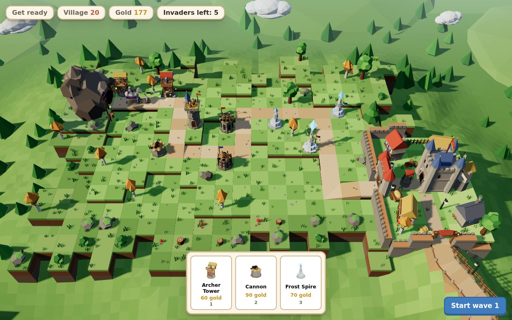
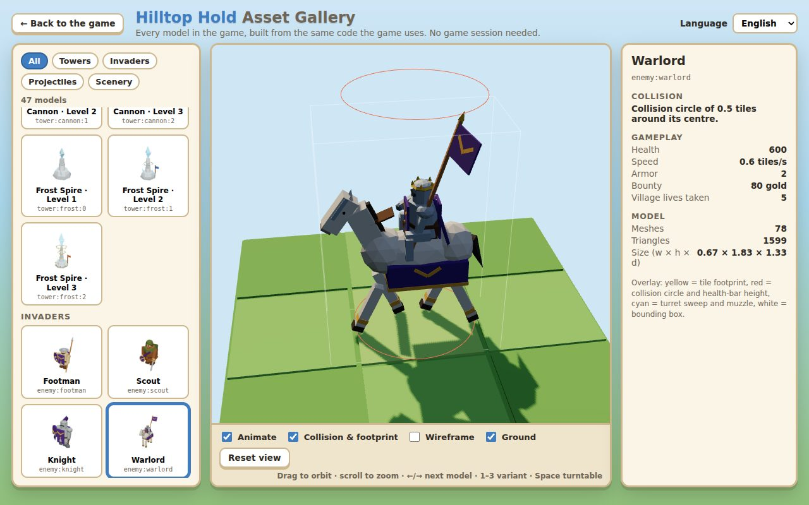
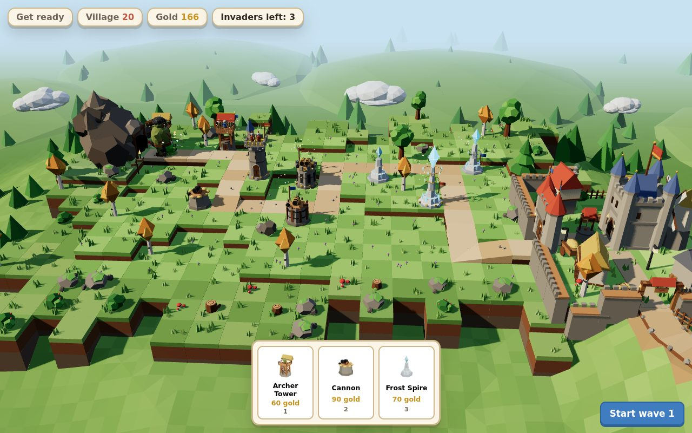
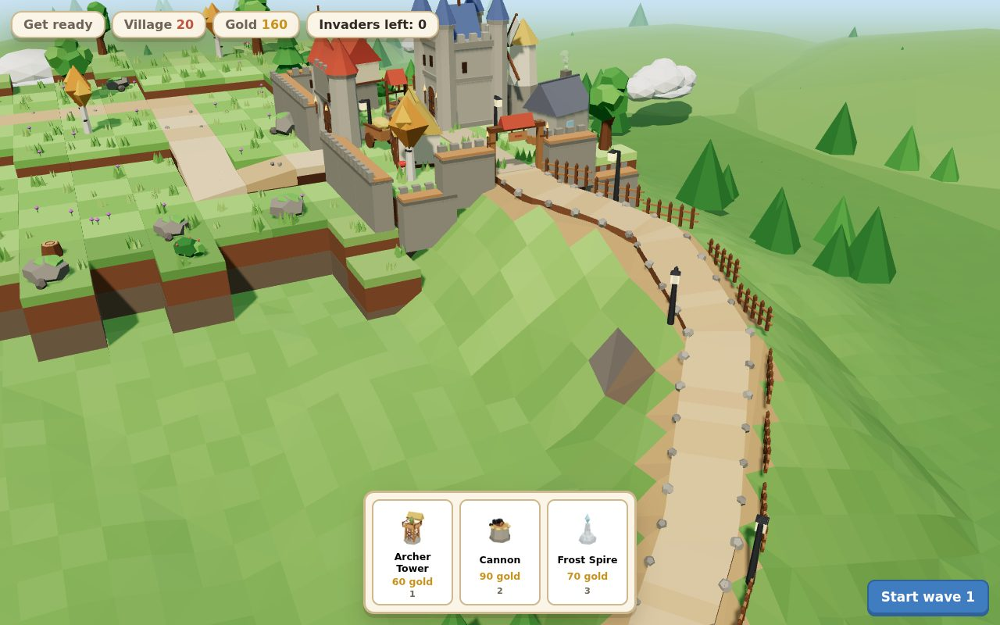

# Hilltop Hold

A low-poly tower defense game built with [Three.js](https://threejs.org/).
The army of a rival lord musters in a tunnel under the crags and marches up
the road toward the village on the hilltop. Build archer towers, cannons and frost spires beside the road,
upgrade them, and hold out for as many waves as you can.

It ships with a **debug menu** in every build (press <kbd>`</kbd> or <kbd>F2</kbd>)
for pausing, stepping and speeding up the simulation, spawning invaders,
showcasing every tower, and drawing the collision shapes, and with an
**asset gallery** (`gallery.html`) that shows every model without running the game.



## Features

- Endless waves of a rival lord's army in one livery: levied footmen with spears and shields, fast hooded scouts, plate-armoured knights, and the warlord himself on a barded warhorse every fifth wave
- Three towers with three upgrade levels each. Every level is a different building (timber post → stone tower → fortified keep, cannon → banded cannon → twin bombard, crystal → orbiting shards → glowing cluster) with banners and heraldry, so the level reads at a glance; selling refunds 70%
- A stepped hilltop: the battlefield is a tiered plateau whose cliffs meet a forested hillside sloping down to a valley with a lake; the road ramps between tiers, the village sits on its own terrace behind a gatehouse and curtain wall, a hill road climbs from the valley to its south archway, and the invaders' cave is dug into a rocky massif
- Long, directional shadows from a low sun (fitted to the scene for sharpness), soft contact shadows under invaders and shots, a gradient sky with fog, a sea of clouds drifting below the hilltop, flickering torches, chimney smoke, a turning windmill, fluttering banners, walk cycles and turret tracking
- Ghost preview of the tower you are about to build, and a range ring draped over the terrain
- A village that lives through the battle: in peace its gate stands open, sentries keep watch and villagers stroll round the well; when invaders appear the alarm bell rings, the gate swings shut, the garrison comes out of the keep and climbs the stairs to the walls to watch them come, and the villagers run for the keep, all more urgent the closer they get
- Invaders storm the gate rather than vanish into it: they climb the road to the door, crowd before it in ranks, and batter it blow by blow, each blow costing the village a life, while your towers can still cut them down; the door is beaten in plank by plank (the masonry around it stands firm), and the garrison hurls stones on attackers that have spent themselves
- Kills are cheered from the walls; a held wave or a slain warlord brings fireworks, a joyful bell, and the villagers back out. If the gate breaks it bursts in, the garrison comes down from the walls and leads the villagers out through the south archway and down the hill road, and the invaders light torches and set the village alight building by building; whoever fires the keep goes in and raises their banner over it, all before the game-over screen
- Fire drawn as GPU particles: flickering flame tongues that cool from white to red, embers, a glow and drifting smoke, for every burning building and every torch in two draw calls
- Gold from kills and wave bonuses, 20 village lives, best wave saved
- Main menu, settings, pause and game-over screens
- Internationalization with English, German and Romanian built in
- Debug menu with time controls, testing cheats, overlays and camera presets, available in every build
- Asset gallery with a turntable viewer, level/variant switching and collision overlays
- No build step, no server, no internet: open `index.html` directly

## Getting started

Double-click `index.html` (or drag it into Chrome).

The game is split into plain scripts that share a `Hold` namespace instead of
ES modules, because browsers refuse to load modules from `file://` URLs. The
script tags at the bottom of `index.html` are in dependency order, so a new
file must be added there after the scripts it uses (`npm test` fails if a
source file is not loaded).

Serving the folder also works: `npm start`, then open `http://localhost:5173`.

The gallery is a second page, `gallery.html`, reachable from the main menu.

## Controls

| Input                 | Action                                      |
| --------------------- | ------------------------------------------- |
| `1` `2` `3`           | Choose archer tower, cannon or frost spire  |
| Left click            | Build the chosen tower / select a tower     |
| Right click           | Cancel building or selection                |
| `Space`               | Start the next wave                         |
| `Esc` / `P`           | Cancel, or pause                            |
| `` ` `` / `F2`        | Toggle the debug menu                       |
| `.`                   | Step one frame (while debug-paused)         |



## Asset gallery

Open `gallery.html` (or **Asset Gallery** in the main menu). It loads only the
model code and game data, so it works without a game session and straight
from disk. It lists every entry of the model catalog with a thumbnail, grouped
into towers, invaders, projectiles and scenery, and shows the selected one on
a turntable with the game's lighting.

- **Variants**: tower levels and scenery kinds switch in place (buttons or <kbd>1</kbd>–<kbd>3</kbd>).
- **Animate** drives the model's animation hooks: walk cycles, turret sweep, orbiting shards, sails, flames.
- **Collision & footprint** draws what the simulation uses: the 1×1 tile a tower occupies (yellow),
  an invader's collision circle and health-bar height (red), the turret's sweep radius and muzzle
  point (cyan), and the bounding box (white). Model tests enforce the same limits.
- **Wireframe** and **Ground** toggles, drag to orbit, scroll to zoom, <kbd>←</kbd>/<kbd>→</kbd> to step
  through models, <kbd>Space</kbd> to pause the turntable.
- The panel shows the gameplay numbers behind the model (cost, damage, range… or health, speed, armor…)
  and mesh/triangle counts. The URL hash deep-links a model (`gallery.html#tower:frost:2`).

## Debug menu

Open it with <kbd>`</kbd> or <kbd>F2</kbd>, or from the main menu. It stays
open between sessions until you close it.

**Time** section:

- **Pause / Resume** the simulation. The screen keeps rendering, so you can
  look at the frozen frame. This is separate from the game's pause screen.
- **Step 1 frame** runs exactly one simulation tick (1/60 s); <kbd>.</kbd> does the same.
- **Step 1 second** runs exactly 60 ticks.
- **Speed** 0.25× to 4×.
- The frame counter and simulated time show exactly where the simulation is.

**Testing** section (for trying the assets and behaviour without playing through):

- **+500 gold**, **+10 lives**, **Lives → 1**.
- **Spawn** one invader of each kind on the road right now, in any phase.
  Between waves it still marches on the gate and attacks it; during a wave it counts towards the wave.
  With **Lives → 1**, one spawned invader is enough to see the village fall.
- **Kill all**, **Clear shots**, **Start wave**, **Skip 5 waves** (jumps the counter, then starts the wave).
- **Showcase all towers** builds every tower at every level, free, on buildable tiles beside the road,
  so all nine models can be compared in place. **Max all towers**, **Sell all towers**.
- Any of these starts a run first if you are on the menu.

**Overlays & camera** section:

- **Collision shapes**: invader collision circles (red), tower footprints and ranges (yellow),
  turret sweep radii (cyan) and splash impacts (orange), all following the terrain height.
- **Road & tiers**: the road's centre line draped over the hill with a post at every tile, taller on higher tiers.
- **Tile grid**: every tile outlined at its own height; green buildable, red blocked, grey outside the map.
- **Pointer hit**: where the pointer ray meets the ground and which tile was picked.
- **Wireframe**, **Shadows**, **Freeze ambient motion** (clouds, flames, smoke, sails, banners run on real time; this stops them).
- **Camera** presets: default, low angle (shows the hillside, clouds and sky), top-down, hill road, village, cave,
  siege (the gate and the village from the road; the game glides there when the village falls).

**Render** section: frames per second, draw calls and triangles, entity counts, and the hovered tile with its tier and height.

### How it stays exact

The simulation (`src/sim/World.js`) only ever moves in fixed ticks of 1/60 s.
`TimeController` turns real time into whole ticks: speed changes how many
ticks run per real second, never their length, and stepping runs one tick
through the same function as the game loop. Anything that should freeze with
the simulation (particles, turret turning, the wave countdown) advances by
simulated time, not real time.

The same seed and the same inputs therefore always give the same game, at any
speed or frame rate. On a very slow machine a long frame is capped at 0.25 s
of real time, so the game runs in slow motion rather than skipping ahead.

Walk cycles, turret turning, orbiting shards and particles advance by simulated
time too, so a paused frame is frozen. Only ambient scenery motion (clouds,
torches, smoke, the windmill, banners) runs on real time, and the debug menu
can freeze that as well.

### Adding a debug tool

Each tool is a section registered with the debug menu:

```js
game.debug.addSection({
  id: 'cheats',
  titleKey: 'debug.cheats.title',      // locale key for the heading
  build(container) { /* create controls once */ },
  update() { /* refresh text; runs every frame while the panel is open */ },
});
```

See `src/debug/timeControls.js` for a complete example, and add its strings
under `debug.` in every locale.



## The hill, heights and collision

The simulation is flat: positions are tile coordinates and the path is a
polyline through tile centres. Heights are purely visual and live in one
place, `src/view/terrain.js`, which every view reads:

- Each tile sits on a whole **tier** (`TIER_HEIGHT` = 0.35 apart), quantised
  from a smooth hill shape that rises towards the north-east. Buildable tiles
  are therefore always flat, and towers stand on `tileTop(col, row)`.
- The **road** ramps linearly between the tiers of consecutive path tiles
  (`pathHeight(distance)`), so invaders never pop up or down; their model is
  placed at the height of their path distance. Projectiles interpolate from
  the tower's muzzle height to the target's ground height (plus an arc for cannon shots).
- `heightAt(x, y)` gives the ground anywhere (road surface, tile top, or the
  valley floor beyond the hill); effects, props and the range ring use it.
- **Picking** (`MapView.pickTile`) intersects the pointer ray with every
  tile's top plane and keeps the nearest hit, so a raised tile in front
  correctly hides the lower one behind it. Nothing outside the map is pickable.
- A ragged ring of extra tiles surrounds the map and drops as cliffs onto a
  **hillside** (`hillside(x, y)`) that slopes from the cliff foot down to the
  valley floor, so the hill sits on the land rather than floating. The village
  terrace behind the gate is one tier above the road, and the road's last
  tile (the gate tile) climbs to it, so the door's sill meets the road and
  invaders can reach the door; the cave massif rests on
  a shelf at the spawn's tier. On the camera side of the ring only short props
  are placed, so nothing hides a tile.
- The **hill road** (`approach`) leaves the village's south archway level
  with the terrace, then descends on an embankment with an eased profile to
  the valley floor and off the bottom of the screen. Ring tiles are kept off
  its corridor and the hillside never rises above it.
- **Clouds** drift in lanes around the foot of the hill, always below y = 0.
  Both the camera and every tile top are above that plane, so no cloud can
  ever come between them, wherever it drifts.
- Decorative grass and flowers are instanced per tile and hidden under a
  tower when one is built there, so nothing pokes through its footing.

Models follow matching rules, enforced by `tests/models.test.js`: a tower's
static parts stay inside its tile, its turret may overhang at most 0.68 tiles,
every level is taller than the last, an invader's torso matches its collision
radius in `src/data/enemies.js`, and projectiles point along +Z.

**Human scale.** `modelKit.HUMAN` fixes how tall a person is (`figure`, the
archers) and how tall a door must be (`door`). Every door is built with
`modelKit.door()`, which refuses to make one shorter than that; the tests
check that every door is taller than the people on its building and stands
on the ground.

**Invader look.** The invaders are ordinary medieval soldiers of one rival
army, not monsters. They share one livery (`unitModels.LIVERY`: purple with
an ochre chevron), which never matches the player's blue, crimson and gold;
they have plain human faces (`head`), real arms and armour (spear and round
shield, shortsword and buckler, plate with a great helm and kite shield, a
war banner), and nothing on them glows. Foot soldiers are human-sized: the
top of the head sits between the archers' height and a door's. The tests
check the livery, the weapon, a single human head, human size and the
absence of glowing parts.



## The gate and the village

The road ends at the gate tile's centre; the door's face stands
`ASSAULT.gateFace` further on (`src/data/enemies.js`), and `MapView` places
the gatehouse so its door is exactly there (the village tests cast a ray
down the road to check).

**The assault** (`src/sim/World.js`). An invader that reaches the gate does
not vanish. Invaders crowd in front of the door in ranks, in order of
arrival: the front rank is as wide as the passage between the drum towers,
the ranks behind fill the road back round the bend, and nobody stands
inside anybody else or walks through the door. The front rank (`state`
'assault') raises its weapons for `ASSAULT.windup`, then strikes every
`strike` seconds; each blow is a `gateHit` event and costs the village one
life. An invader lands `lives` blows in all (so undefended, a wave costs
exactly what it always did), then the garrison's stones fell it
(`repelled`, no bounty). The ranks behind (`queue`) wait and step up as the
front thins. Towers keep shooting all of them: the crowd is what is furthest
along the road, so towers target it first, and killing an attacker stops its
remaining blows. When the last life goes the gate breaks (`gateBroken`, then
`gameOver`), the phase is `over`, and the simulation keeps running (shots in
flight land). The invaders pour through the gatehouse (`sack`), light torches
(`ASSAULT.light`), and each goes to the nearest building nobody has taken
yet, walking the village's paths; it stands where the village plan says
(`VILLAGE_PLAN.targets`) and holds its torch to the building for
`ASSAULT.kindle` seconds (`torch`), then moves on. Whoever fires the keep
goes in through its door (`keepTaken`); the gatehouse is fired from inside,
where its timber roof is in reach. With nothing left to burn they gather
in the square. Nothing burns unless an invader set it alight: the farmhouse
behind the keep, which no path reaches, is spared.

**The village plan** (`src/data/village.js`) lays out everything behind the
gate in tiles from the gate tile: the buildings (those that can burn are
named), walls, lanes, the stone stairs up to the wall walks, and the paths
everyone walks: named points joined by straight legs, on the ground or on a
wall walk. The garrison, the villagers and the invaders all go by these
paths (`PathNetwork` in `src/sim/path.js` finds routes), so nobody walks
through a wall or a building; the village tests check every leg against the
buildings' outlines. Move a building and its paths with it.

**The village** (`src/view/VillageView.js`) reads the World every frame and
reacts to its events, on simulated time, so it freezes with the simulation:

| The battle | The village |
| ---------- | ----------- |
| Peace | The gate stands open, two sentries watch from the walls, villagers stroll round the well |
| Invaders anywhere (alert) | The bell tolls, the gate swings shut, the men of the garrison come out of the keep one after another and climb the stairs to their posts, where they turn to watch the nearest invader; villagers run into the keep |
| Invaders within 7 tiles (danger) | Faster bell, spears levelled and bows raised |
| Invaders at the gate (siege) | Frantic bell, the garrison shakes its weapons; every blow jolts the leaves on their hinges and throws splinters off the door (a shower of them when a plank gives way), while the gatehouse itself never moves; the HUD's village card pulses |
| Lives lost | The door is beaten in by the share of the gate destroyed, so almost every blow breaks something new: planks scarred, then smashed through to splintered stubs from the middle of the door outward (you see through the gaps past the cross battens), weapons left stuck in it, the iron bands snapping, the leaves buckling and splintered wood piling up at its foot |
| An attacker spent | The nearest guard heaves a stone onto it as the garrison fells it |
| A kill | A guard cheers; near the gate the whole garrison does |
| Wave held, warlord slain | Fireworks from the keep in the village's colours, a joyful bell, the garrison cheering, the gate opening and the villagers coming out; once all is quiet the men called up go back down into the keep |
| The gate breaks | The door bursts; the garrison runs down from the walls and, with the villagers coming out of the keep, leaves through the south archway and down the hill road |
| A building torched | Flames start where the torch touched it, take the roof a few seconds later and the walls blacken; smoke and firelight |
| Burning a while (7–17 s by building) | It comes down: spires (the keep's turret roofs, the gatehouse's cones, the windmill's sails) topple and shatter where they land, the roof falls in with a burst of dust and sparks, timber and plaster storeys crumble, and a charred ruin is left (wall stubs, fallen rafters, rubble, glowing coals); stone storeys stand blackened; the fires flare, sink onto the rubble and die down to a smoulder under thicker smoke. It goes on behind the game-over screen |
| The keep taken | The lord's banner comes down and the invaders' goes up |

When the gate breaks the game keeps running (state `fallen`): the camera
glides to the **siege** preset while its people flee and the invaders set it
alight, and only then does the game-over screen come up, low on the screen
with the village burning above it. Every model involved is in the gallery:
the gate at each damage stage, the guards, the villagers and the war banner.

**Burning down.** Each building that can burn marks, in its model, what
fire brings down (`structure` in `src/models/scenery.js`): a `roof` that
falls in, an `upper` storey of timber and plaster that crumbles, `spires`
that topple (each knows which way it falls) and a hidden `ruin` of what is
left. Stone storeys are not marked and stay standing. The village view
brings them down after the building has burnt for a while
(`COLLAPSE` in `src/view/VillageView.js`) and puts them back on a new run.

**Fire** (`src/view/FireSystem.js`) is drawn on the GPU: each fire is a set
of camera-facing puffs that loop on their own clocks, so nothing is spawned
on the CPU. Flames are born across the fire's footprint, lick upward while
drawing in to tongues, sway, and cool from white through yellow and orange
to red; a few are embers, a few a soft glow; smoke rises above, swells,
drifts downwind and pales. Every burning building and every torch together
cost two draw calls. The fires run on simulated time, like the rest of the
battle.

## Lighting and shadows

`src/render/Lighting.js` is shared by the game and the gallery. The sun sits
low in the west (`SUN_DIRECTION`), so shadows are long enough to read while
the fronts of models stay lit; the sky fill is kept low and slightly blue so
shaded sides stay cool and deep. `fitShadow` fits the sun's orthographic
shadow camera to the scene's bounding box as seen from the light, so the
whole shadow map (4096² on desktop GPUs, 2048² elsewhere) lands on the
battlefield, village, cave and near hillside. Invaders and projectiles also
get a soft contact shadow on the ground beneath them (tilted to the road's
slope), which shows where a cannonball will land.

## Tests

```bash
npm test
```

The simulation and time controller run in Node, without a browser or GPU.
The tests cover the map path, building, upgrades and selling, enemies walking
to the gate, the assault (ranks that never overlap or pass the door, only the
front rank striking, blows one at a time, the garrison felling spent
attackers, towers stopping blows, the gate breaking, and the sack: only lit
torches held to a building for a while set it alight, every reachable
building once, the keep taken by whoever fired it), targeting,
armor, splash, slow, wave composition, game over,
determinism with a fixed seed, the debug helpers (spawning, killing, setting
levels, skipping waves), and the time controller (fixed ticks, scaling,
pausing, stepping, slow-frame capping). The terrain tests check that every
tile is on a whole tier, that the road ramps without jumps and meets every
tile top, that heights agree between the road, tiles and valley, and that the
village and cave are where they should be. The model tests check fit and
collision (above), human scale, the invaders' look, baking, and animation
hooks, the gate (a real doorway whose leaves swing inward onto an open
passage, beaten in a little more by almost every blow), what fire brings down
in every building (and that the ruin left is lower than the roof was) and
the invaders' attack rigs. The
village tests drive the village view from a real World and check each
reaction above, from peace to the fall and back after a reset: that nobody
is ever inside a wall or under the ground, that the men called up climb the
stairs and go back down, that everyone leaves through the south archway when
the gate falls, that only what the invaders torch burns, that the gatehouse
never moves while its door is beaten in, that a building burns a good while
before it comes down and then lies in ruins while the spared ones stand, that
every path leg clears the buildings, that the door stands where the
simulation puts it, and that no guard ever hides a battlefield tile. The scene tests build the real map view in Node and check, from the
exact player camera at several window shapes, that no scenery and no
drifting cloud ever hides a battlefield tile; that clouds stay below the
hilltop and clear of the hillside; that the hill road climbs from the valley
to the village and runs off the bottom of the screen; that the hillside meets
every cliff foot; and that picking matches real ray casts. They also check that every
language has the same text keys, that every catalog entry builds and has a
name, and that every script is loaded by `index.html` or `gallery.html`.

## Project structure

```
index.html                Canvas, HUD, screens, debug panel and script load order
gallery.html              Asset gallery page (models, data and i18n only)
vendor/three.min.js       Three.js r165 bundled as a global `THREE` script
css/style.css             Game UI styling
css/debug.css             Debug panel styling
css/gallery.css           Gallery layout
src/
  namespace.js            Creates the shared `Hold` namespace
  main.js                 Entry point
  Game.js                 Renderer, lighting, screen flow, input, camera presets, debug API
  core/
    TimeController.js     Fixed-step time: pause, step, speed
    math.js, storage.js, Settings.js
  data/
    map.js                The battlefield as text rows
    enemies.js            Invader stats (incl. collision radius, blows on the gate) and how they storm it (ASSAULT)
    towers.js             Towers and their upgrade levels
    waves.js              Starting gold/lives and endless wave generation
    village.js            The village plan: buildings, walls, stairs, paths, posts, and what invaders burn
  sim/
    path.js               Parses the map and traces the enemy path; routes over the village's paths
    World.js              The whole simulation (incl. the assault on the gate); no rendering; debug helpers
  models/
    kit.js                Primitives, palette, materials, baking, turret sweep
    animation.js          Animation hooks (spin, hover, flutter, flicker, sway, limb)
    towers.js             Three towers × three levels
    units.js              Invaders and projectiles
    scenery.js            Nature, the cave, the village (gate beaten in plank by plank, buildings that burn down to ruins, garrison, villagers, war banner)
    catalog.js            Every model by id, with group, label, footprint and variants
  render/
    Lighting.js           Sun, fill, fitted shadows, sky dome, renderer settings (game and gallery)
    cameraRig.js          Camera presets, blending and placement (game and tests)
    Thumbnailer.js        Draws icons and gallery cards from the models
  view/
    terrain.js            Height model: tiers, road profile, hillside, hill road, heightAt (no Three.js)
    MapView.js            Terrain, hillside, hill road, decoration, props, cave, village, clouds, marker, ghost, range ring, picking
    UnitsView.js          Towers, enemies (health bars, contact shadows, blows at the gate) and projectiles on the terrain
    VillageView.js        The village reacting to the battle: gate, bell, garrison, villagers, celebrations, evacuation, fires
    FireSystem.js         GPU particle fire: flames, embers, glow and smoke for burning buildings and torches
    Effects.js            Particles (hits, splinters, rubble, collapse dust and sparks, fireworks), advanced by simulated time
    DebugOverlay.js       Collision, road, grid, pointer and wireframe overlays
  ui/
    UI.js                 Screens, toasts, settings, game over
    Hud.js                Stats, build bar, wave button, tower panel with level icons
  debug/
    DebugMenu.js          Debug panel and section registry
    timeControls.js       Time section
    testControls.js       Testing, overlays & camera, render sections
  gallery/
    Gallery.js            Asset browser and turntable viewer
    main.js               Gallery entry point
  i18n/                   Translation service and en/de/ro locales
tests/                    Node tests (`npm test`)
```

## Common changes

**Edit the map.** Change the rows in `src/data/map.js`. The path must be one
unbranched line from `S` to `E`; the game refuses to start with a broken
path and tells you where it breaks.

**Add a tower.** Add an entry to `TOWERS` in `src/data/towers.js`, a builder
in `src/models/towers.js` (expose `userData.turret` tagged with
`userData.role = 'turret'`, plus `userData.muzzle` and `userData.height`), a
projectile in `src/models/units.js`, and `towers.<id>` text in every locale.
It appears in the build bar, the gallery and the tests automatically; number
keys follow the list order. Keep static parts inside the tile and make each
level taller than the last, or `npm test` will say so.

**Add an invader.** Add it to `ENEMIES` in `src/data/enemies.js` (with a
`radius` that matches its torso, its `lives` and `strike` at the gate, and a
`reach` if it sticks out further in front) and to the roster in
`src/data/waves.js`, add a model in `src/models/units.js` (use `withBody`,
which tags the body and sets the health-bar height; pass an `attack` and tag
the arm that swings the weapon with `weaponArm`), and `enemies.<id>` text in
every locale.

**Add scenery.** Add a `build<Name>(variant)` in `src/models/scenery.js`, list
it in `SCENERY` in `src/models/catalog.js` with its number of variants, add
`scenery.<name>` text in every locale, and place it: in the village through
`VILLAGE_PLAN` in `src/data/village.js` (keep it off the paths; the village
tests will tell you), elsewhere from `MapView` (the `CAVE_PROPS` and
`RING_PROPS` tables). Parts that should
move get an animation hook in `userData` (see `src/models/animation.js`);
everything else is baked into a single mesh when placed.

**Change the hill.** The shape is the `field` function in
`src/view/terrain.js`; tier size, valley depth, ring width, the hillside
(`MOUND_TOP`, `MOUND_RADIUS`), the hill road (`APPROACH`) and the lake are
constants next to it. The road and the tests adapt automatically. Use the debug
menu's **Road & tiers** and **Tile grid** overlays and the **Low angle**
camera to check the result.

**Tune balance.** Tower stats, enemy stats, wave size and scaling, starting
gold and lives are all in `src/data/`.

**Add a setting.** Add the default in `src/core/Settings.js`, a field in the
settings form in `index.html`, an entry in `SETTING_FIELDS` in `src/ui/UI.js`
and its label in every locale.

**Add a language.** Copy `src/i18n/locales/en.js` to e.g. `fr.js`, change the
first line to `Hold.locales.fr = {`, translate the strings (keep the keys and
`{placeholders}`), and add a script tag for it in `index.html` before
`i18n.js`. Missing keys fall back to English.

## Updating Three.js

```bash
npm install && npm run vendor
```

## License

MIT. Three.js is MIT licensed, see `vendor/three.LICENSE`.
